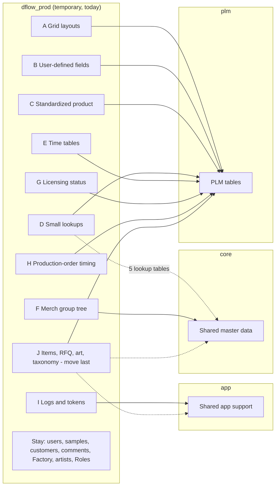

# DesignFlow production: which tables can move together (2026-11-05)

Source: live read-only catalog read of production `dflow_prod` foreign keys
(`qsllyeztdwjgirsysgai`, 2026-11-05), plus each table's permanent home in `plm` / `core` / `app`.
Re-derive before acting. Foreign keys only catch database-declared links. Many legacy
DesignFlow tables are joined in app code with no foreign key, so the groups below
add the business-area links too.

## The plan at a glance

Order: A to I can each move on its own, easiest first. J moves last. K does not move.

## How a partial move works

The DesignFlow services already decide each table's schema separately (`config/table-schema-map.js`).
Production forces everything into one schema today. A partial move means turning on
per-table placement in production, keeping `dflow_prod` as the default, and listing
only the moved group. Every service that reads a table must ship the same map entry.

## Groups, easiest first

Each destination is the existing same-name table in that schema, as listed in
`designflow-master-data-migration/designflow-schema-segregation.md`.

| # | Group | Moves to | Tables | Notes |
|---|---|---|---|---|
| A | Grid layouts | `plm` | GridAccessLevel, GridChildrenLayout, GridChildrenLayoutOrder, GridLayout, GridViewState, grid_cell_notes | No links out |
| B | User-defined fields | `plm` | UDFComponent, UDFElement, UDFElementType, UDFGroup, UDFQuery, UDFTable | No links out |
| C | Standardized product | `plm` | StandardizedDetail, StandardizedGroup, StandardizedProductElement, StandardizedProductElementValue, StandardizedProductType, StandardizedSize, StandardizedVendor, StandardizedVersion | No links out |
| D | Small lookups | `plm`, except product_category, merchGroupHeaders, vendorGroup, externalCustomer, externalVendor → `core` | FOBCountry, ShippingPort, ProdPaymentTerms, ProdShipmentTransitTime, deliveryLocation, externalApi, ProductNickname, itemSize, itemDepth, itemType, product_category, merchGroupHeaders, vendorGroup, externalCustomer, externalVendor | Reference lists |
| E | Time tables | `plm` | DesignTeamTime(s), FactoryTimes, LicensingTime(s), OrderLeadTime, LicenseFeedBacks, licensingMilestone | Reference lists |
| F | Merch group tree | `core` | merchGroupMaster, merchGroupRelations | Linked to each other |
| G | Licensing status | `plm` | licensingStatus, groups, licensingFeedbackReply | Linked to each other |
| H | Production-order timing | `plm` | ProdOrderHeader, FactoryTime, prod_order_milestone_schedule, product_type_factory_time | Linked. ProdOrderDetail is in group J |
| I | Logs and tokens | `app` | AuditLog, email_logs, ai_cache_events, auth_token, quote_auth_token, app_settings, AdditionalUserEmail | Tokens and extra emails belong to users, so move them only after a check that nothing joins them to users |
| J | Core cluster (59 tables, linked) | `plm` for items, RFQ, art, orders, division/company/season codes; `core` for licenseList, merchGroup, age_group, art_types, artist_types, vendor, property_character_associations; `app` for RolePermissions, UIElements, user_notification; stays in `dflow_prod`: users, all sample tables (owner ruling: samples stay together), Factory, artists, Roles, user_roles, properties_and_characters | all sample tables, users, Roles, user_roles, RolePermissions, UIElements, user_notification, itemHeader, RFQItem, item_* links, art_piece(_attachment), artists, artist_types, art_types, Factory, properties_and_characters, property_character_associations, licenseList, merchGroup, age_group, vendor, divisionCode, companyCode, SeasonCode, RFQStep, ProdOrderDetail | Holds the blocked tables and those that must stay put (users, samples). Move last |
| J+ | Same area, no foreign key | `plm` | itemDetail, itemAttachment, RFQGroup, RFQVendor, RFQContainer, RFQItemDivision, RFQItemStatus, RFQWhse | Joined to items/RFQ in code. Move with J |

## Must stay in `dflow_prod` (no permanent home)

customers, comments, item_customer_selling, vendor_wechat_identity, tracking_grid_archive,
merchGroup_04112026, merchGroup_pr90_bad (the last two look like old backup copies).

## Data check still owed for every group

Each permanent home already holds rows (an older copy). For each group, decide whether to
adopt the existing rows or replace them with current production rows before it moves.
